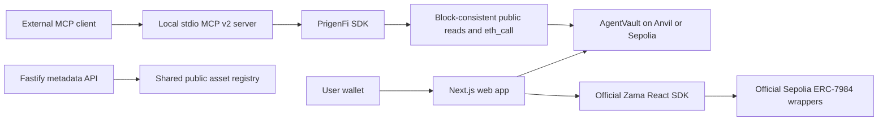

# Architecture

## Working boundaries

| Component                      | Responsibility                                                                                        | Authority                                 |
| ------------------------------ | ----------------------------------------------------------------------------------------------------- | ----------------------------------------- |
| `apps/web`                     | Marketing, docs, injected wallet, vault controls, confidential tools                                  | User signs wallet transactions            |
| `contracts/src/AgentVault.sol` | Immutable owner, per-agent/token limits, nonce, recipient, expiry, pause/revoke, withdrawal           | Owner policy; agent's own scoped transfer |
| `VaultFactory.sol`             | Create independent vaults, emitting owner/vault event                                                 | Caller becomes owner                      |
| `MockUSD.sol`                  | Six-decimal local faucet                                                                              | Chain 31337 only, no value                |
| `packages/shared`              | Zod schemas, exact units, chain/asset constants, generated ABI/bytecode                               | Single authoritative definitions          |
| `packages/sdk`                 | Verify vault runtime code, fixed-block policy reads, simulation, ephemeral proposals, recent activity | Read/eth_call only                        |
| `packages/zama`                | Wrapper discovery verification and official SDK facade                                                | User wallet only                          |
| `services/mcp-server`          | Ten tools, fixed operator-configured vault/agent/token, stdio                                         | No signing or execution                   |
| `services/api`                 | Public metadata, health/readiness, rate limits, redacted logs                                         | Loopback, no private endpoints            |

The frontend directly uses the same SDK and on-chain contracts as MCP. The metadata service is optional; it does not pretend to provide authentication or agent persistence. Vault events are the source of ownership and execution truth. Browser receipts are session history; the SDK indexes only the latest 1000 blocks, without a durable reconciler or finality guarantees.

## Vault permission and proposal flow

1. User creates a vault, or loads an existing vault whose runtime code matches the generated artifact with immutable locations masked.
2. User funds it via direct ERC-20 transfer, without approval to a general router.
3. User authorizes an agent/token/recipient tuple with amount caps and expiry.
4. The SDK pins policy and balance reads to one block. Its simulation checks scope, budget, nonce and a five-minute proposal deadline, then calls `executeTransfer` via eth_call.
5. MCP may store an allowed simulation in its bounded process-local session. It never submits it.
6. A connected agent wallet can submit the fixed transfer directly. The vault independently rechecks its policy. No arbitrary target/selector is accepted.

The application has no trade venue, price oracle, quote, swap, signed trade-intent execution, durable queue or autonomous execution runtime. A proposal deadline is off-chain freshness, not an on-chain EIP-712 expiry. Direct Ethereum transactions bind caller, chain and nonce; vault nonces add application replay protection and survive reauthorization.

## Confidential path

The user separately verifies Sepolia wrapper code, underlying code/address, decimals and rate. Zama hooks orchestrate mint (public faucet call), shield, permit authorization, balance decryption, encrypted transfer, unshield and session recovery. Confidential amounts are not in the agent vault policy. The browser keeps separate in-memory SDK/query stores and remounts on account or network change. MCP and API never consume decrypted state.

## Future boundaries

Add an audited ERC-4337/7579 account/session adapter without replacing vault policy. Add SIWE/ERC-1271 authentication, PostgreSQL tenant-scoped persistence, OAuth-protected remote MCP, durable execution reconciliation and vetted testnet venues in subsequent vertical slices. Base and Arbitrum public-token adapters are future capabilities; no FHE support is asserted.

## November 8 frontend and Ethereum-market read model

The Next.js `apps/web/src/app/(marketing)` route group has its own marketing layout; `(workspace)` has its own wallet-aware sidebar and top bar. Customer pages use shared UI and wallet providers without leaking consumer navigation into the public site. `/vault` preserves wallet-owned restricted ERC-20 contract operations; `/portfolio` separates Zama confidential asset tools from public vault scopes; `/activity` reads recent, verified contract events (no profit inference).

`GET /api/markets?q=...` is a public, read-only Next route querying the fixed DEX Screener pair search endpoint, filtering `chainId === ethereum`, validating addresses, and normalizing/slicing public metadata. The client displays data source, cache age and no-execution disclosures; public search terms can reach the provider. It is **not** a risk oracle, account-trading API, or confidential route. Chart components consume normalized pool volume and liquidity figures, not client-generated market prices.

`apps/web/src/lib/performance.ts` computes win rate and realized returns only from an upstream _verified finalized closed-position dataset_. The current app does not have that indexer and intentionally passes no trades to the conditional UI. No synthetic profit numbers appear on user pages. Performance fixtures exist in unit tests only.

## Confidential-only research vs. execution gate

`packages/shared/src/index.ts` now contains seven official Zama Sepolia unbacked test wrapper addresses, their actual technical `Mock` identifiers, consumer display labels, underlying tokens and test flags. `packages/zama` verifies wrapper and underlying code, exchange `rate` and decimals at the active chain block before unlocking wallet-scoped operations. Do not hardcode all tokens to 6 underlying decimals: cZAMA, cWETH and some other wrappers differ.

`packages/shared/src/confidential-policy.ts` owns a typed per-market draft schema with `privacy: confidential-only` as a literal invariant. `assessConfidentialTrade` currently returns `executionAllowed=false` for every market because no verified encrypted trading venue or authenticated agent execution service is connected. Both new read-only local stdio MCP tools (`confidential_capabilities_get`, `confidential_route_check`) expose the same policy without storing private instructions or signing transactions. Existing public ERC-20 vault test transfers, simulations and proposals are unrelated to private trade execution and MUST NOT be used as a fallback.

Target flow: authenticated wallet/user → optional private agent reasoning → typed private mandate → supported protocol/market compatibility proof → encrypted testnet trade simulation → on-chain authorized agent policy → independently verified confidential settlement → privacy-safe indexer → verified analytics. A public Ethereum market-data provider is a separate research input and may observe queries. It is not an FHE execution channel. The user's instructions stay local in the current implementation; this is not an operational AI trading agent yet.

## Zama ConfidentialSwap read-only verification boundary — November 8, 2026

The source-of-truth registry under `infra/zama-registry` is an upstream, unchanged `testnet.json` plus `manifest.json`; the tracked JSON is intentionally excluded from Prettier so the official SHA-256 remains reproducible. `scripts/verify-confidential-swap.ts` verifies the manifest digest and exact Sepolia registry identity before consulting JSON-RPC. The shared pure `inspectZamaSwapVenue` reader snapshots chain ID, block number, proxy code, ERC-1967 implementation storage, implementation code and the standard UUPS `proxiableUUID()`. All external calls are read-only and pinned to one block.

`GET /api/confidential-venue` uses a server-controlled Sepolia RPC and a four-minute server cache. The browser `/privacy` surface displays the read model but has no interaction that can sign, decrypt, quote or send a trade. Read errors return a redacted blocked status (no RPC URL leaked). On-chain proxy/UUPS presence and even bytecode hashes do **not** prove any pair liquidity or FHE/private-order compatibility. All agent and confidential trading policy gates remain unchanged and false.

## Shared EVM market-data and MCP agent reasoning — November 9, 2026

The new `@prigenfi/shared/market-research` module is a fail-closed public research boundary. The web `/api/markets?chain=...&q=...` and local MCP `market_search` and `market_pair_lookup` invoke the same bounded DEX Screener adapter. It checks an explicit EVM research chain list, validates token and pair addresses, restricts public token symbols/address searches, retains source and fetch timestamp, and does not mix data from other chains. Exact token addresses use the per-chain token-pairs endpoint; globally ranked symbol searches can return no results for an otherwise active chain. No synthetic data fills the gap. Every returned pair has `privateTradingAvailable:false`.

A connected MCP host may use `interpret_private_defi_goal` to have its **own model** interpret a voluntarily shared user goal. Before issuing public market reads, it can submit its chosen network, token and domain through `agent_market_research_check`, which checks against caller-provided research constraints, rejects stale steps and returns minimal nonsecret reason codes. This is not owner-signed authority and does not persist a session. Actual private execution will require verified FHE-aware EVM venue contracts, owner authentication, audited smart-account permissions, limited session keys, deterministic risk guards and finalized settlement reconciliations.

Anvil-only ERC-20 vault read/simulate tools are conditionally registered on local-chain 31337; ordinary MCP clients cannot see or call them. There is no transaction submission path in the normal MCP interface.
