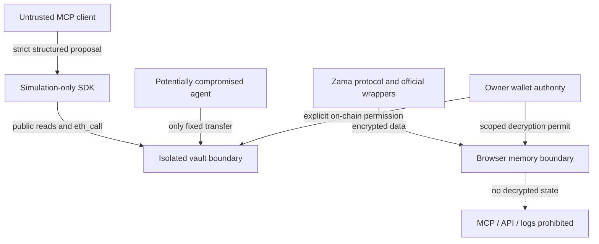

# Threat model

## Assets and trust boundaries

Assets: principal wallet authority, allocated ERC-20 vault capital, agent policy, FHE plaintext/permits, proposal integrity and transaction provenance. Adversaries include compromised agents, malicious clients, token contracts, RPC operators, third-party metadata sources and compromised browsers. The owner, chosen wallet implementation and official Zama/FHE network are trusted dependencies with distinct responsibilities.

| Threat                                | Implemented defense / evidence                                                                           | Remaining exposure                                                                               |
| ------------------------------------- | -------------------------------------------------------------------------------------------------------- | ------------------------------------------------------------------------------------------------ |
| Compromised agent credentials         | Vault-only capital; recipient/token caps; expiry, pause and revoke tests                                 | Agent can consume its authorized budget; owner key compromise controls the vault                 |
| Prompt injection / malicious metadata | No LLM or text-to-execution path; strict schema rejects arbitrary instructions/calls; no signer in MCP   | A future runtime must sanitize/bound data and preserve provenance; not implemented               |
| Unauthorized target/selector          | Only executeTransfer(token,recipient,amount,nonce); no call/approve router                               | User may authorize malicious token code                                                          |
| Unlimited ERC-20 approval             | Vault never approves; direct deposits; Zama shield uses exact approval                                   | SDK/underlying token trust remains                                                               |
| Session escalation                    | Owner-only policy; agent cannot withdraw, manage or unpause; negative tests                              | ERC-4337 session modules are not integrated/tested                                               |
| Replay / cross-chain                  | Direct EVM signer/chain transaction semantics; persistent per-agent vault nonce; unsupported-chain tests | No EIP-712 signed intent executor shipped; reorgs can roll back state                            |
| Incorrect network                     | Chain schema allows only 31337/11155111; RPC ID checked; contract chain guards; UI unsupported state     | Malicious RPC/browser can mislead display                                                        |
| Reentrancy                            | OpenZeppelin guard and state-before-interaction; adversarial callback test                               | Depends on compiled code integrity                                                               |
| Unusual ERC-20                        | SafeERC20, failure rollback, fee-on-top debit rejection tests                                            | Fee-on-transfer received amount not guaranteed; lying/rebasing/proxy token risks                 |
| Slippage manipulation                 | No swaps/quotes/execution venue exists                                                                   | Future adapter needs minimum received, expiry and independent policy                             |
| Unauthorized decryption               | Opt-in scoped permit, memory-only stores, account-keyed remount; SDK guard tests                         | Real ACL negative tests and Sepolia decryption not yet run                                       |
| MCP token leakage/passthrough         | No remote bearer-token endpoint; no token inputs or arbitrary signer                                     | OAuth audience/resource validation is pending, remote endpoint must remain absent                |
| Decimal mistakes                      | Strict decimal text → bigint; wrapper decimal/rate reads; excess precision rejected                      | Future assets may use unsupported decimal ranges                                                 |
| Duplicate execution                   | Nonces; failed-token rollback; idempotency conflict tests; no automatic retry queue                      | Proposal keys are session-local, not durable transaction idempotency                             |
| Stale quotes/policy                   | No quotes; one-block policy/eth_call; bounded proposal deadline                                          | Snapshot may age after simulation; contract rechecks caps but has no off-chain proposal deadline |
| Backend tenancy bypass                | No private endpoints or address-selected user portfolios                                                 | Authentication/database authorization not built; must precede hosted persistence                 |
| Finality assumptions                  | Receipts labeled included, event reads observed/unfinalized                                              | No durable indexer, reorg reconciler, confirmation policy or finality tracking                   |
| Spoofed existing vault                | Runtime bytecode verification, masked immutable positions, before SDK policy and UI load                 | New compiler/release artifacts require explicit migration support                                |
| Cross-user private cache              | Private query provider/stores isolated, key by account/chain and token; no analytics                     | Browser/XSS/dependency compromise remains a risk                                                 |

## Security properties tested

- Agent recipients receive at most the authorized daily budget across arbitrary transfer attempts.
- Vault capital remains at least initial capital minus that budget; local standard-token capital is conserved.
- An operation cannot exceed its cap, skip/reuse nonce, execute while paused/revoked/expired, change token or recipient, or execute on mainnet.
- A reverting, false-returning or fee-on-top token cannot consume nonce/accounting or overspend.
- A token callback cannot reenter agent execution even when that callback address has its own permission.
- Only the immutable owner can manage policy or withdraw, including while paused.
- MCP proposals never create submitted/executed state; allowed and denied simulations are independently checked on actual local chain.

Mark-to-market losses, MEV, oracle manipulation and confidential spending limits are not modeled as hard guarantees. There is no price feed, venue, position accounting or encrypted vault policy. No cryptographic primitive was implemented by PrigenFi.
